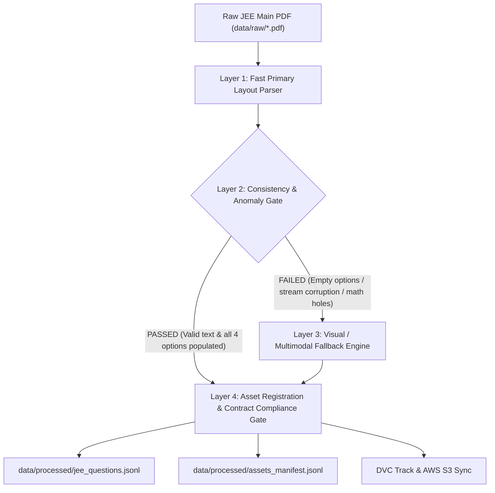

# Track D Strategy & Schema: JEE Main Question Extraction Pipeline

**Document Version:** `2.0.0`  
**Track:** Track D (JEE Main Question Extraction)  
**Author:** Shrey Ritesh & MLOps Team  
**Contract Conformance:** [data/data_contract.md](file:///c:/Users/shrey/Desktop/Engineering%20notes/3rd%20YEAR/MLOps%20EL/MLOPS-Project/data/data_contract.md) (Section 5 & Section 6)  
**Output Target:** `data/processed/jee_questions.jsonl` and `data/processed/assets_manifest.jsonl`

---

## 1. Track D Purpose & Scope

Track D is responsible for extracting, structuring, validating, and versioning all **JEE Main Examination Questions** (MCQs and Numerical Value Questions) from raw PDF papers into canonical, reproducible JSON Lines (`.jsonl`) records.

### Key Objectives:
1. **Question Segmentation:** Accurately extract all 75 questions per JEE Main paper across Physics, Chemistry, and Mathematics.
2. **Options & Answer Key Pairing:** Extract options (1-4) for Section A (MCQs) and map official answers from the paper's answer key table without fabricating data.
3. **Mathematical & Chemical Notation Preservation:** Preserve superscripts, subscripts, Unicode math symbols, matrices, and reaction strings.
4. **Visual Asset Cropping & Decoupled Linking:** Identify non-text figures (circuits, graphs, reaction schemes), crop them at 300 DPI into `data/assets/crops/`, register them in `assets_manifest.jsonl`, and link `asset_ids` in `jee_questions.jsonl`.
5. **Cascading Layered Architecture:** Guarantee 100% boundary accuracy across disjoint PDF font streams using a fast primary parser backed by an automatic consistency gate and visual fallback.
6. **Pydantic Validation & DVC Sync:** Validate every record against `JEEQuestionRecord` and push the dataset to the team AWS S3 bucket.

---

## 2. Cascading Multi-Tier Extraction Architecture

JEE Main papers (especially MathonGo LaTeX outputs) compile English text, mathematical symbols, and option values into **separate, disjoint font streams**, causing naive linear text parsers to drop inline math and dump all option values into Option 4.

To solve this deterministically, Track D implements a **4-Layer Cascading Architecture**:



---

### Layer-by-Layer Functionality

#### 🟢 Layer 1: Fast Primary Layout Parser
* **Role:** Rapid, local, zero-cost extraction of blocks and question candidates.
* **Mechanism:**
  * Uses PyMuPDF structured block extraction (`page.get_text("blocks", sort=True)`).
  * Filters recurring header/footer branding (`"JEE Main Previous Year Paper"`, `"MathonGo"`).
  * Chunks questions by question boundaries (`Q1.`, `Q2.`, etc.).
  * Performs initial option grid parsing (`(1)`, `(2)`, `(3)`, `(4)`).

#### 🟡 Layer 2: Consistency & Anomaly Validator (Quality Gate)
* **Role:** Automated inspection of Layer 1 candidates to detect internal PDF font-stream corruption and incomplete question text.
* **Quality Check Criteria:**
  1. **Question Text Consistency & Completeness:**
     - *Dangling Math Clauses:* Detects incomplete sentences where math expressions were dropped (e.g. `"domain of is :"`, `"components along and perpendicular are"`, `"values of is :"`).
     - *Unbalanced Brackets:* Checks for unmatched parentheses, brackets, or braces (`(`, `[`, `{`).
     - *Minimum Length & Substance:* Flags question statements that are truncated, empty, or shorter than 20 characters.
     - *Question Bleeding:* Flags accidental ingestion of subsequent question markers (e.g., `Q10.`, `Q11.`).
  2. **Option Structure & Value Integrity:**
     - *Empty Option Check:* Are any MCQ options empty (`text == ""`)?
     - *Option Dumping Check:* Does Option 4 contain leftover label markers or >70% of total block text?
     - *Option Label Sequencing:* Verifies presence and ordering of all 4 options `[1, 2, 3, 4]`.
* **Action:**
  * If **PASSED** $\rightarrow$ Candidate marked `extraction_status: "success"` and forwarded directly to Layer 4.
  * If **FAILED** $\rightarrow$ Automatically routes the question to **Layer 3 (Visual Fallback)**.

#### 🔴 Layer 3: Visual / Multimodal Fallback Engine (Targeted Recovery)
* **Role:** Visual layout recovery for corrupted or math-heavy questions.
* **Mechanism:**
  * Renders the source page at 300 DPI.
  * Crops the exact visual bounding box $[x_0, y_0, x_1, y_1]$ of the failing question.
  * Employs multimodal visual parsing to transcribe the 2D layout directly:
    * Reassembles complete inline LaTeX math (`[x]`, $\frac{m}{n}$, $\begin{bmatrix}\dots\end{bmatrix}$).
    * Populates distinct option text for each label `[{"label": "1", "text": "..."}, ...]`.
    * Flags any embedded non-text visual figures for asset cropping.

#### 🔵 Layer 4: Asset Registration & Contract Compliance Gate
* **Role:** Final schema validation, image asset cropping, and Data Contract v1.0.0 enforcement.
* **Mechanism:**
  * **Visual Figure Handling:** If a question contains a diagram, circuit, or graph:
    * Crops graphic to `data/assets/crops/ast_<sha256>.png`.
    * Registers entry in `data/processed/assets_manifest.jsonl` with `bbox`, `sha256`, `source_page`.
    * Links `asset_ids: ["ast-<sha256>"]` and adds inline `[IMAGE: ast-<sha256>]` in `question_text`.
  * **Text Questions:** Sets `asset_ids: []`.
  * **Metadata Enforcement:** Sets `difficulty: null`, `difficulty_source: "unknown"`, `difficulty_status: "unknown"`.
  * **Validation:** Serializes through `JEEQuestionRecord`.

---

## 3. Handling Complex Edge Cases

| Case | Challenge | Layered Resolution Strategy |
| :--- | :--- | :--- |
| **Disjoint Font Streams (e.g. Q1, Q5)** | Math symbols and option values rendered in separate PDF streams, leaving options 1-3 empty. | Caught by Layer 2 anomaly gate (`empty_options_check`); resolved by Layer 3 visual reconstruction. |
| **2D Matrices & Calculus** | 2D matrices ($A = \begin{bmatrix} 1/\sqrt{2} & -2 \\ 0 & 1 \end{bmatrix}$), integrals ($\int_0^2$), fractions ($\frac{m}{n}$). | Transcribed into clean inline LaTeX (`\begin{bmatrix}...\end{bmatrix}`) or referenced with high-res crop. |
| **Diagrams & Circuits (Physics/Chem)** | Diode circuits, ray diagrams, $v-t$ graphs, chemical reaction mechanisms. | Layer 4 crops the graphic to `data/assets/crops/`, registers in `assets_manifest.jsonl`, and links `asset_ids: ["ast-..."]`. |
| **Numerical Value Questions (Section B)** | Questions 21–25, 46–50, 71–75 have no multiple-choice options. | Assigned `options: []` with integer/decimal in `correct_answer`. |
| **Official Answer Keys** | Summary answer grid on final page of PDF. | Ingested into memory map `{1: "3", ..., 21: "14"}` and joined by `q_num` without fabrication. |

---

## 4. Canonical Pydantic Schema (`src/models/jee.py`)

Every record in `data/processed/jee_questions.jsonl` strictly conforms to the Data Contract v1.0.0 specification:

### 4.1 Field Specification

| Field Name | Type | Required | Description |
| :--- | :--- | :---: | :--- |
| `question_id` | `string` | **Yes** | Stable unique ID (e.g. `jee-2025-28jan-s2-q01`). |
| `source_id` | `string` | **Yes** | SHA-256 derived ID matching `source_manifest.jsonl`. |
| `year` | `integer` | **Yes** | Exam year (e.g. `2025`). |
| `session` | `string` | **Yes** | Exam session (e.g. `"28 Jan"`). |
| `shift` | `string` | **Yes** | Exam shift (e.g. `"2"`). |
| `subject` | `string` | **Yes** | `"Physics"`, `"Chemistry"`, or `"Mathematics"`. |
| `question_text` | `string` | **Yes** | Extracted problem statement with inline math/image tags. |
| `options` | `list[JEEOption]` | **Yes** | Array of 4 options (empty `[]` for Section B NVTs). |
| `correct_answer` | `string \| null` | **Yes** | Official key answer (e.g. `"3"`, `"14"`). |
| `solution_text` | `string \| null` | **Yes** | Step-by-step solution if provided, else `null`. |
| `source_page` | `integer` | **Yes** | 1-based physical page index in the source PDF. |
| `asset_ids` | `list[string]` | **Yes** | Associated diagram asset IDs (e.g. `["ast-..."]` or `[]`). |
| `extraction_status`| `enum` | **Yes** | `"success"`, `"needs_review"`, or `"failed"`. |
| `difficulty` | `enum \| null` | **Yes** | Preset to `null`. |
| `difficulty_source`| `enum` | **Yes** | Preset to `"unknown"`. |
| `difficulty_status`| `enum` | **Yes** | Preset to `"unknown"`. |

---

## 5. Sample Canonical Records

### Pure Text/Math Question:
```json
{
  "question_id": "jee-2025-28jan-s2-q05",
  "source_id": "src-f7ebd97f5b2c85d0885c70e1639100960385dc35ff8bcc19fecf9d7e630742fb",
  "year": 2025,
  "session": "28 Jan",
  "shift": "2",
  "subject": "Mathematics",
  "question_text": "Let [x] denote the greatest integer less than or equal to x. Then the domain of f(x) = sec^{-1}(2[x] + 1) is :",
  "options": [
    {"label": "1", "text": "(-∞, -1] ∪ [0, ∞)"},
    {"label": "2", "text": "(-∞, -1] ∪ [1, ∞)"},
    {"label": "3", "text": "(-∞, ∞)"},
    {"label": "4", "text": "(-∞, ∞) - {0}"}
  ],
  "correct_answer": "3",
  "solution_text": null,
  "source_page": 1,
  "asset_ids": [],
  "extraction_status": "success",
  "difficulty": null,
  "difficulty_source": "unknown",
  "difficulty_status": "unknown"
}
```

### Visual Diagram / Circuit Question:
```json
{
  "question_id": "jee-2025-28jan-s2-q45",
  "source_id": "src-f7ebd97f5b2c85d0885c70e1639100960385dc35ff8bcc19fecf9d7e630742fb",
  "year": 2025,
  "session": "28 Jan",
  "shift": "2",
  "subject": "Physics",
  "question_text": "In the circuit shown here [IMAGE: ast-8f2c3a4b5d6e7f80], assuming threshold voltage of diode is negligibly small, then voltage V_AB is correctly represented by :",
  "options": [
    {"label": "1", "text": "V_AB would be zero at all times"},
    {"label": "2", "text": "[IMAGE: ast-9a0b1c2d3e4f5a6b]"},
    {"label": "3", "text": "[IMAGE: ast-1a2b3c4d5e6f7a8b]"},
    {"label": "4", "text": "[IMAGE: ast-2b3c4d5e6f7a8b9c]"}
  ],
  "correct_answer": "4",
  "solution_text": null,
  "source_page": 6,
  "asset_ids": [
    "ast-8f2c3a4b5d6e7f80",
    "ast-9a0b1c2d3e4f5a6b",
    "ast-1a2b3c4d5e6f7a8b",
    "ast-2b3c4d5e6f7a8b9c"
  ],
  "extraction_status": "success",
  "difficulty": null,
  "difficulty_source": "unknown",
  "difficulty_status": "unknown"
}
```

---

## 6. Execution Commands

```powershell
# 1. Run the Cascading Multi-Tier Extractor
python -m src.data.jee_extractor

# 2. Run Test Suite
pytest tests/test_jee_extractor.py -v

# 3. Track with DVC & Sync to S3 Remote
dvc add data/processed data/assets
dvc push
```
